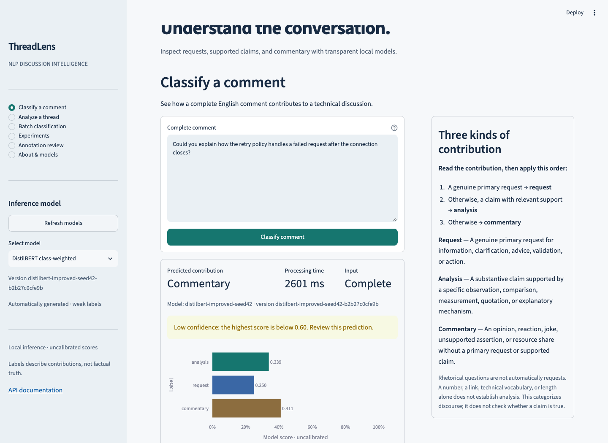
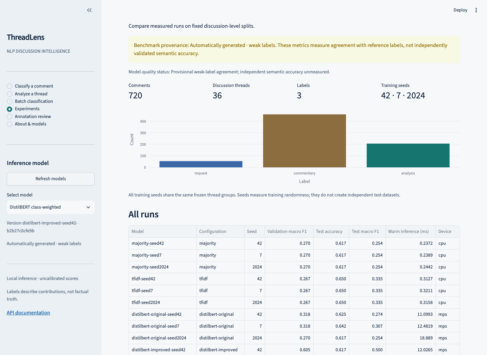
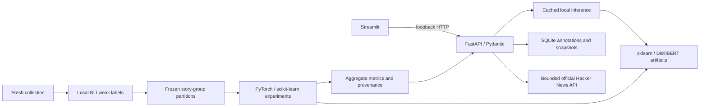

# ThreadLens — NLP Discussion Intelligence

[](https://github.com/sawantamar05/threadlens-nlp/actions/workflows/ci.yml)

Understand how people contribute to technical discussions: **analysis**, **request**, or **commentary**. ThreadLens is a local Python application by **Amar Sawant**, with individual prediction, Hacker News thread exploration, CSV batches, experiment reports, and provenance-aware annotation review.

> **Model-quality status: provisional.** The benchmark uses automatically generated, unreviewed weak labels. Metrics measure agreement with a local NLI teacher. Independently validated semantic accuracy is **unmeasured**. This application categorizes discourse; it does not verify factual truth.

## Actual application screenshots

The trained model classifies original synthetic prose below. The low-confidence result illustrates a real model mistake rather than a curated claim of correctness. The experiment screen uses the recorded weak-label benchmark. Screenshots were captured in Chromium from the running application.





[Selected model confusion matrix](docs/images/trained-confusion-matrix.png) · [Narrow viewport](docs/images/trained-prediction-narrow.png) · [Synthetic batch workflow](docs/images/demo-batch-results.png) · [Synthetic annotation review](docs/images/demo-annotation-review.png)

## What you can do

- Classify complete comments using a trained local DistilBERT model or baseline; inspect scores, version, latency and truncation warnings.
- Analyze a bounded sample from a Hacker News story, filter contribution types, and follow source links.
- Process CSVs with progress feedback, preserve row order and source columns, and download spreadsheet-safe results.
- Compare actual baseline/transformer runs, per-label metrics, confusion matrices, seed variation, and one bounded improvement experiment.
- Review labels blindly, preserve original weak drafts, and save append-only revisions with explicit provenance.
- Run the synthetic demonstration offline after installing dependencies. No paid inference APIs or cloud account is required.

## Quickstart

Tested on Apple M3 / 16 GB / macOS 26.6.2 / Python 3.11.0; neural runs use MPS. CPU inference and lightweight CI are also supported. Python 3.11 is the documented reproduction version. Use a source checkout and editable installation so UI/data/report assets are available.

```bash
git clone https://github.com/sawantamar05/threadlens-nlp.git
cd threadlens-nlp
python3.11 -m venv .venv
.venv/bin/python -m pip install uv==0.13.5
.venv/bin/uv pip sync requirements.lock
.venv/bin/uv pip install --no-deps -e .
.venv/bin/threadlens doctor
.venv/bin/threadlens demo
.venv/bin/threadlens serve --demo
```

The public repository intentionally excludes real model weights and raw comment text. **The demo trains a small TF-IDF classifier on 30 original synthetic fixtures; it is separate from the real benchmark.** The real local installation uses `threadlens serve` after artifacts are rebuilt.

- UI: <http://127.0.0.1:8501>
- API: <http://127.0.0.1:8000>
- Interactive API docs: <http://127.0.0.1:8000/docs>
- Stop: **Ctrl+C** in the launcher terminal, or `.venv/bin/threadlens stop` from another terminal. Restart with the same `serve` command. The stop command checks the recorded process start time and identity before signaling it.
- Port conflict: add `--api-port 8001 --ui-port 8502`. The launcher stops only its own children.

## Taxonomy

| Category | Meaning |
|---|---|
| request | Genuine primary request for information, clarification, advice, validation or action, even with technical background. |
| analysis | Substantive claim with a specific observation, comparison, measurement, relevant quotation or explanatory mechanism. |
| commentary | Opinion, reaction, joke, unsupported assertion or resource share without a primary request or supported claim. |

Decision order: **primary request → supported claim → commentary**. Rhetorical questions are not automatically requests. A link, number, technical vocabulary or length alone is insufficient support. Mixed-intent comments, quoted questions, implied requests, and evidence requiring parent context can be ambiguous; see the [data card](docs/data_card.md).

## Architecture and stack



FastAPI/Pydantic provide typed validation and OpenAPI; Streamlit/Plotly make the local workflows inspectable; SQLite preserves collection and annotation state; scikit-learn supplies transparent baselines and metrics; PyTorch/Transformers enable actual local fine-tuning. A process-local inference manager reuses models; the UI has no duplicate transformer. Ruff, pytest, and GitHub Actions check maintainability. See [architecture](docs/architecture.md).

## API examples

With either real or demo services running:

```bash
curl http://127.0.0.1:8000/health
curl http://127.0.0.1:8000/ready
curl http://127.0.0.1:8000/models
curl http://127.0.0.1:8000/predict \
  -H 'Content-Type: application/json' \
  -d '{"text":"Could you explain how you measured cache latency?"}'
curl http://127.0.0.1:8000/predict/batch \
  -H 'Content-Type: application/json' \
  -d '{"texts":["Could you explain that result?","I like this idea."]}'
curl http://127.0.0.1:8000/analyze-thread \
  -H 'Content-Type: application/json' \
  -d '{"story":"8863","limit":5}'
```

`POST /predict` returns `label`, named `scores`, `model_id`, `model_version`, `truncated`, `processing_ms`, `low_confidence`, and `warnings`. Scores are uncalibrated preferences, not probabilities of correctness. Limits: 10,000 characters/comment, 100 comments/API batch, 2 MiB API request body, 2 MiB CSV, 1,000 CSV rows; the UI chunks larger files. Missing models return 503, invalid input 422, inaccessible source requests 502. `/health` reports the process; `/ready` actually loads/checks the requested artifact. Additional routes: `GET /experiments`, `GET /review/next?blind=true`, `GET /review/status`, `POST /annotations`, `GET /annotations/{comment_id}`. Defaults are loopback-only.

## Reproduce the real experiment

```bash
.venv/bin/threadlens collect --manifest reports/collection_manifest.json
.venv/bin/threadlens label --device auto
.venv/bin/threadlens split
.venv/bin/threadlens prepare-review
.venv/bin/threadlens experiments --stage initial --device auto
# Inspect the ONE change declared using train/validation evidence:
cat configs/improvement.json
# For a NEW experiment only: commit a changed declaration before improved test evaluation.
# The recorded declaration is already committed in a clone; skip these two lines if unchanged:
git add configs/improvement.json
git commit -m 'Declare validation-selected improvement'
.venv/bin/threadlens experiments --stage improved --device auto
.venv/bin/threadlens evaluate
.venv/bin/threadlens report
.venv/bin/threadlens serve
```

The replay command refetches the published source IDs, verifies cleaned text hashes, and pins the published teacher configuration. It refuses to replace the corpus if source text changed or disappeared. For a fresh sample, `threadlens collect --threads 36 --per-thread 20 --seed 42` discovers current technical discussions.

The checked-in declaration describes this recorded dataset. For a new collection, use a separate `THREADLENS_ROOT` with a new dataset version and copy `configs/preregistration.json` and `configs/model_sources.json`; do not mix a new dataset with the published frozen reports/declaration. The data card explains source drift and exact-ID versus new-sample reproduction. Source comments collected later may be edited/deleted; byte-identical recollection is not guaranteed.

Individual workflow commands also include `train-baselines`, `train-transformer --seed 42 --epochs 3 --device auto`, and `predict 'your complete comment' --model MODEL_ID`. `threadlens --help` lists options. Full comments remain stored; transformer tokenization uses the leading 256 tokens and reports truncation. Initial downloads require internet. Saved tokenizer/model artifacts reload locally; `HF_HUB_OFFLINE=1 TRANSFORMERS_OFFLINE=1` can enforce cache-only operation afterward. Uncached HN thread retrieval still requires internet.

Data retrieval uses the [official HN API](https://github.com/HackerNews/API); Algolia only discovers technical story IDs. The collector caches responses in SQLite and resumes. Fresh data is deterministically sampled, cleaned with paragraph boundaries, language-filtered, and deduplicated. Raw text stays outside Git. The [collection manifest](reports/collection_manifest.json) records IDs, hashes, timestamps, and sampling configuration. The [labeling manifest](reports/labeling_manifest.json) records the NLI teacher revision and hypotheses; the [split manifest](reports/split_manifest.json) records frozen groups. No course assignment material is used.

## Measured experiments

Collected **720 comments from 36 discussions**. Frozen train/validation/test: **500/100/120 comments**, with **25/5/6 disjoint discussion groups**. All labels are unreviewed `weak_label`; none are independently human-labeled.

| Method | Test accuracy, mean | Test macro F1, mean ± std |
|---|---:|---:|
| Majority class | 0.6167 | 0.2543 ± 0.0000 |
| TF-IDF + logistic regression | 0.6500 | 0.3346 ± 0.0000 |
| DistilBERT · original | 0.6278 | 0.2784 ± 0.0219 |
| DistilBERT · class-weighted loss | 0.6417 | 0.4883 ± 0.0836 |

All methods use seeds **42, 7, 2024** on identical frozen partitions; std is population variation across these runs, not a confidence interval. The baselines are deterministic here. Class weighting was the **one** validation-selected change, committed before improved test evaluation. It raised mean test macro F1 from **0.2784 to 0.4883**, while mean accuracy changed from **0.6278 to 0.6417**. No further search was run.

The class-weighted configuration was selected by mean **validation** macro F1 (0.5731 versus 0.3016). The predeclared representative seed 42 is the active local model: test accuracy **0.6167**, macro F1 **0.5003**, request recall **0.50**. Warm MPS model latency averaged **12.03 ms** over 20 sequential single-comment requests after three warmups; tokenization is included, HTTP/UI overhead is excluded.

**The preregistered 0.65 macro F1 goal was missed.** The selected seed's request-recall and latency goals were met; semantic accuracy is still unmeasured. There are only **4 validation and 8 test requests**, so minority estimates are unstable. Detailed per-seed metrics, confusion counts, losses, configuration, versions, source commits, truncation, errors, and goals are in the [experiment report](docs/experiments.md) and [machine-readable results](reports/experiments.json).

## Checks and developer workflows

```bash
.venv/bin/ruff check .
.venv/bin/ruff format --check .
.venv/bin/pytest -q
```

The completed local suite passes **73 tests**, plus Ruff and formatting checks. Both a fresh full environment and a separate torch-free environment passed all 73 tests. Actual trained-model API integration, CPU offline inference, browser workflows and error states passed. See [verification evidence](docs/verification.md).

CI installs `requirements-ci.lock`, a constrained lightweight dependency set without neural-model downloads; local `requirements.lock` includes the tested training stack. Neural training/reload and full application browser checks are run separately on the actual Mac. Browser checks are optional developer tooling: install `playwright==1.64.1`, run `python -m playwright install chromium`, then run:

```bash
.venv/bin/python scripts/browser_smoke.py --url http://127.0.0.1:8501 --prefix trained --model 'DistilBERT class-weighted' --experiments --story 47340079
.venv/bin/python scripts/browser_error_states.py
```

The first command assumes the actual trained artifacts/services exist; for demo services use `--url http://127.0.0.1:8511 --prefix demo --review` after starting `threadlens serve --demo --api-port 8011 --ui-port 8511`. The browser verification report records what actually ran.

## Repository guide

```text
configs/                 preregistration and single improvement declaration
src/threadlens/api/      typed routes and request bounds
src/threadlens/data/     HN collection, CSV validation, frozen group splits
src/threadlens/labeling/  resumable local NLI weak labels
src/threadlens/models/    training, registry and reusable inference
src/threadlens/evaluation/metrics and staged multi-seed experiment runner
src/threadlens/storage/  immutable drafts and append-only review revisions
ui/                      API-backed Streamlit interface
scripts/                 setup and reproducible verification
reports/                 public aggregate results and source-ID manifests
data/demo/               original synthetic functional fixtures
docs/                    cards, architecture, portfolio and execution evidence
```

See [data card](docs/data_card.md), [model card](docs/model_card.md), [experiment report](docs/experiments.md), [troubleshooting](docs/troubleshooting.md), [progress and handoff](docs/progress.md), and [LinkedIn/résumé materials](docs/portfolio.md).

## Limitations, attribution, and license

Weak labels can encode teacher errors and fail the taxonomy's intent distinctions. Small minority support makes metrics unstable. Fixed seeds do not measure source-sampling uncertainty. Popular technical discussions and an English/length filter create selection bias; the tool has not been validated for other communities or languages. Truncation, parent-context dependence, and uncalibrated confidence further limit use. No hosted production deployment, external users, business impact, or independent human-labeling claim is made.

Original code and synthetic fixtures: [MIT](LICENSE), Amar Sawant. Public pretrained DistilBERT and NLI DistilRoBERTa checkpoints: Apache 2.0, recorded revisions. Raw HN comments remain local because public access does not provide a blanket text redistribution license. See [third-party attribution](docs/third_party.md).

Built with substantial **OpenAI Codex assistance** for implementation, testing, experiment execution, and documentation. AI-generated labels and automated review are disclosed. This original personal portfolio project is separate from CodePath assignments.
