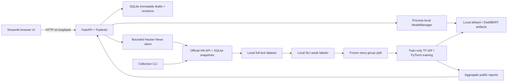

# Architecture

ThreadLens maps a complete English discussion comment to a discourse category. The category is a prediction about the contribution, not a fact check. Requests take precedence over supported analysis; everything else is commentary.

## Boundaries

- `src/threadlens/config.py` defines label order, paths and input limits. API defaults to `127.0.0.1:8000`; Streamlit defaults to `127.0.0.1:8501`. This is a local single-user research tool, without a hosted multi-user authentication layer.
- `api/app.py` validates typed inputs and delegates to shared services. `/docs` exposes OpenAPI. The UI sends HTTP requests and never loads neural weights; one API process caches requested artifacts and serializes access through the model manager.
- `models/inference.py` owns artifact loading, tokenizer truncation flags, score mapping, device reporting, and CPU fallback. The only model names clients can select are registry IDs. Missing or incompatible artifacts produce an actionable 503; health remains separate from readiness.
- `data/hn.py` only accepts bounded positive story IDs or exact HTTPS HN item URLs. It fetches source text through the official Firebase API, with bounded concurrent requests, retry/backoff, snapshots and deterministic sampling. Algolia is used only to discover technical discussion IDs.
- `data/csv_io.py` validates UTF-8 CSVs with a `text` column, row and byte limits, complete non-empty text, and character limits. The UI sends chunks of at most 100 and appends output columns without reordering rows. Exports escape formula-like cells.
- `storage/annotations.py` retains original drafts separately from append-only label revisions. Blind review hides suggestions until initial submission. Exposed AI suggestions prevent claiming subsequent independent human annotation. Synthetic source records remain synthetic. Agent-driven review uses AI-assisted provenance.
- `labeling/weak.py`, `models/training.py`, and `evaluation/runner.py` own reproducible experiments outside the API. Full comments are preserved locally. Weak labeling uses overlapping windows; DistilBERT initially sees the leading 256 tokens with dynamic padding. Runtime responses flag truncation.

## Reproducibility and leakage

One frozen dataset hash and story-group split is shared by every method and all three training seeds. The seeds vary optimization randomness; they do not estimate split uncertainty. Learned preprocessing fits on training rows only. The test set reports agreement after configuration decisions; the single improvement is declared from train/validation evidence and committed before improved test evaluation. All original and improved runs remain available.

Large weights, raw texts, local predictions, caches and databases are excluded from Git. Public aggregate reports and source ID manifests allow inspection without redistributing the complete comment corpus. Recollection may differ because source items can change or disappear.

## Developer lifecycle

`threadlens serve` checks port availability, starts API then UI, waits for health and prints readiness and log paths. It stays in the foreground. Ctrl+C terminates its own child handles and waits for cleanup; no unrelated process is stopped. `threadlens stop` checks the recorded launcher PID, start time, and full command before sending SIGTERM; a stale or reused PID is refused. The launcher then cleans up its own child handles and removes its run record. `--api-port` and `--ui-port` handle conflicts. `--demo` uses a separate `.local/demo` root containing an original synthetic TF-IDF fixture. A fresh clone can rebuild the demo entirely offline after dependencies are installed.

The editable installation is run from a source checkout because `ui/`, `data/demo/` and public reports are repository assets. A standalone wheel without those assets is not a supported distribution.
